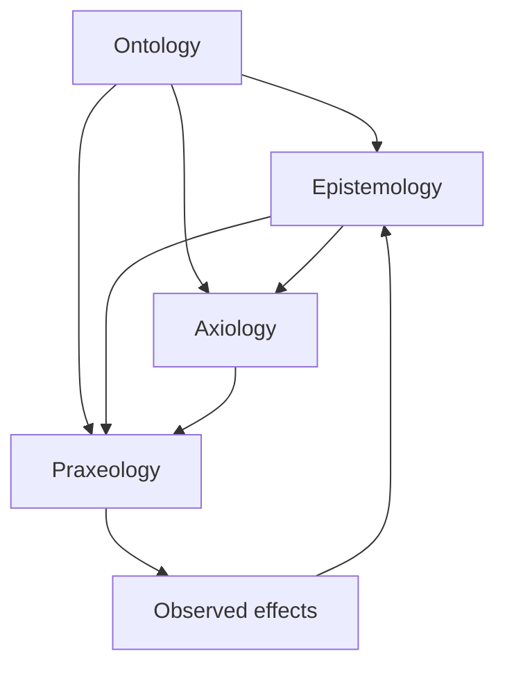

# RCF 0.2.0 — Normative specification

RCF defines a vocabulary for describing agency and cognition in situated systems. The specification is independent of implementation language, storage engine, model architecture, and consciousness. The four original essays are informative philosophical foundations; this directory defines the normative exchange contract.

## Reading order

1. [Terminology and common contracts](terminology.md)
2. [Ontology (RCO)](ontology.md)
3. [Epistemology (RCE)](epistemology.md)
4. [Axiology (RCA)](axiology.md)
5. [Praxeology (RCP)](praxeology.md)
6. [Cognition (NTFS)](cognition.md)
7. [Exchange and conformance](conformance.md)

The exchange example is [garden.json](../examples/garden.json); expected interpretations and rejection cases are in [conformance scenarios](../examples/conformance.md).

## Dependency boundaries

Dependencies describe semantic inputs, not import order. Cognitive strategies operate across all four domains, while feedback is an exchange of records rather than a circular ownership dependency.

## Version and scope

0.2.0 specifies record shape, identity, references, conditions, and invariants. It does not prescribe a belief revision algorithm, execution engine, unified utility function, transport protocol, or an empirical account of human cognition. 0.3 will define dynamics and strategy protocols; 0.4 will provide a reference implementation. A conforming 0.2 implementation may support an explicitly declared subset of domains and MUST reject or report unsupported records rather than silently reinterpret them.
