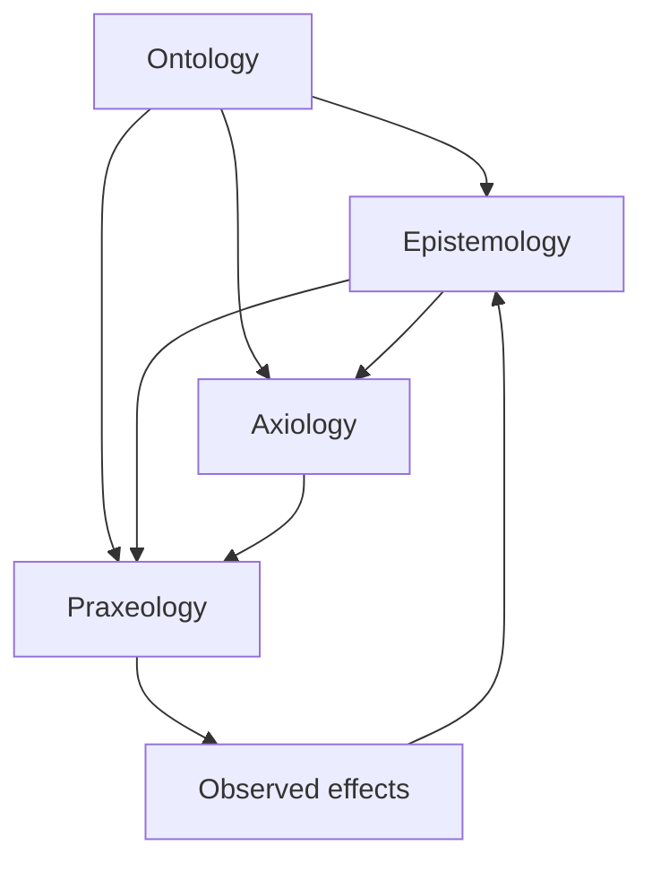

# RCF 0.3.0 — Normative specification

RCF defines a vocabulary for describing agency and cognition in situated systems. The specification is independent of implementation language, storage engine, model architecture, and consciousness. The four original essays are informative philosophical foundations; this directory defines the normative exchange contract.

## Reading order

1. [Terminology and common contracts](terminology.md)
2. [Ontology (RCO)](ontology.md)
3. [Epistemology (RCE)](epistemology.md)
4. [Axiology (RCA)](axiology.md)
5. [Praxeology (RCP)](praxeology.md)
6. [Cognition (NTFS)](cognition.md)
7. [0.2 exchange and record conformance](conformance.md)
8. [Formal dynamics and state transitions](dynamics.md)
9. [Cognitive strategies and belief revision](strategies.md)
10. [Deliberation, authorization and feedback](deliberation.md)
11. [Concurrency and partial ordering](concurrency.md)
12. [0.3 dynamics conformance](conformance-0.3.md)

The 0.2 record exchange example is [garden.json](../examples/garden.json) with [record conformance scenarios](../examples/conformance.md). The 0.3 behavioral example is [dynamics.json](../examples/dynamics.json) with [dynamics scenarios](../examples/dynamics-conformance.md).

## Dependency boundaries

Dependencies describe semantic inputs, not import order. Cognitive strategies operate across all four domains, while feedback is an exchange of records rather than a circular ownership dependency.

## Version and scope

0.2.0 specifies record shapes, identity, references, conditions, and invariants. 0.3.0 extends these contracts with state-transition requests and receipts, strategy-run and revision policy protocols, deliberation, action lifecycle, feedback, and safe concurrent application semantics. It prescribes **no universal** belief algorithm, execution engine, utility function, transport protocol, or scientific model of human cognition; 0.4 remains the reference-implementation milestone. Conformance classes are declared explicitly; a records-only consumer MUST NOT claim behavioral or concurrency conformance. 0.2 bundles remain valid under their declared version, and unverified external authority remains unverified.
